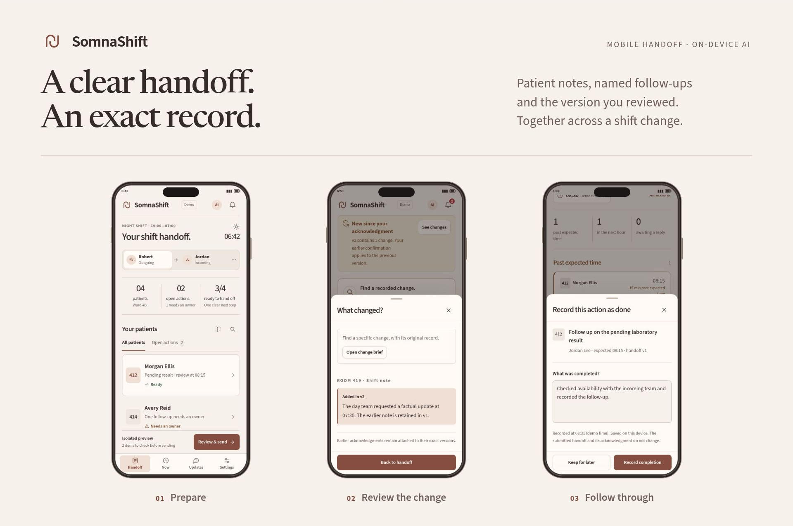
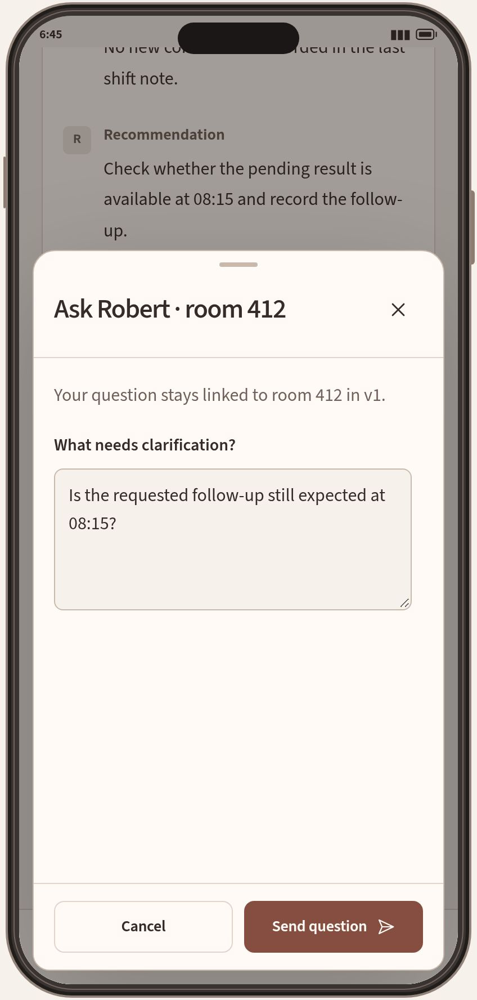
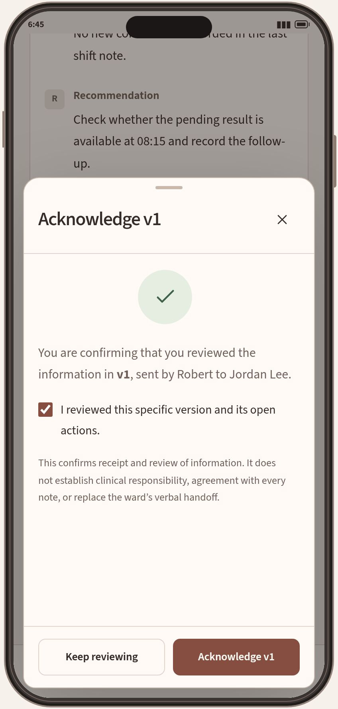
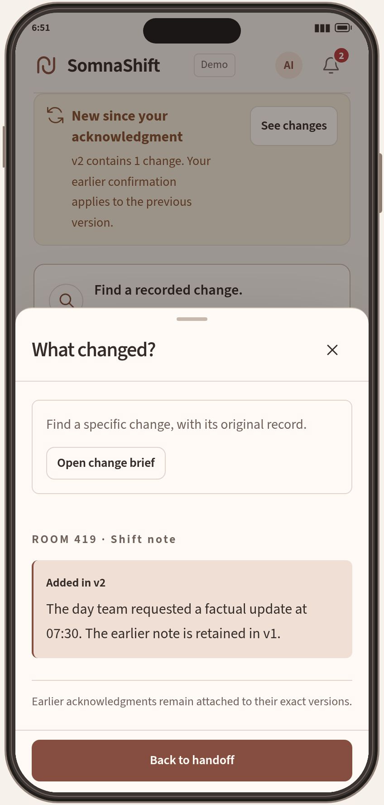
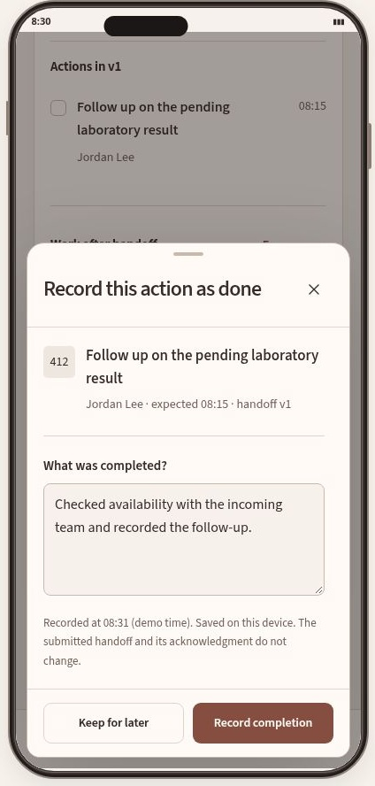
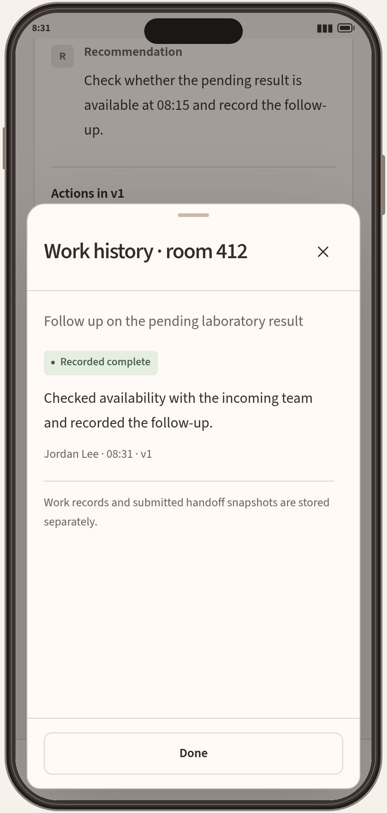
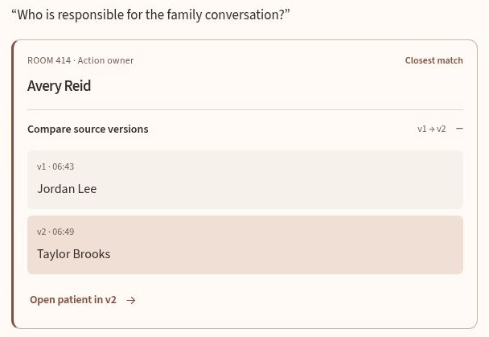
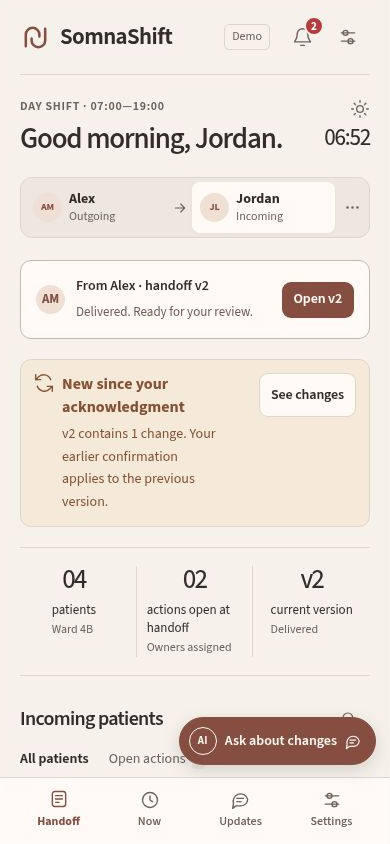
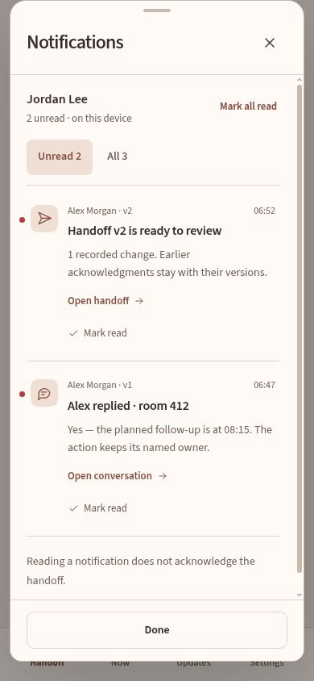

<div align="center">

  <picture>
    <source media="(prefers-reduced-motion: reduce)" srcset="docs/media/mark-still.png">
    
  </picture>

  # SomnaShift

  **Carry the context forward.**

  Mobile shift handoff · Product design & working prototype<br>
  Designed by **Robert Vaganian**

  [](package.json)
  [](https://github.com/RobertVaganian/somnashift/actions/workflows/verify.yml)
  [](dist/app.mjs)
  [](package.json)
  [](#on-device-ai-find-the-change-keep-the-source)
  [](#from-phone-to-desktop)

  [Open the prototype](https://robertvaganian.github.io/somnashift/) ·
  [Case study](https://robertvaganian.github.io/somnashift/case-study/) ·
  [Try local AI](https://robertvaganian.github.io/somnashift/shift/?scene=assist&screen=detail&brief=1&briefmode=local) ·
  [Run locally](#run-locally)

</div>

---

A sent message is not a completed handoff. SomnaShift keeps patient notes, named follow-ups and the exact reviewed version together as one colleague hands over to the next.

**The scenario:** Jordan has reviewed **v1**. Alex adds a room-419 note and sends **v2**. The earlier confirmation stays with v1; Jordan can find the new information, ask a question and acknowledge v2 separately. Work completed afterward gets its own record.



## Inside the handoff

Six moments from the working mobile prototype. Select a screen to inspect it at full size.

<table>
  <tr>
    <td width="33%" valign="top" align="center"><strong>01 · Prepare</strong><br><br><a href="docs/screenshots/portfolio/01-prepare.jpg"></a><br><sub>Find the outstanding checks before sending.</sub></td>
    <td width="33%" valign="top" align="center"><strong>02 · Clarify</strong><br><br><a href="docs/screenshots/portfolio/03-clarify.jpg"></a><br><sub>Keep the question with its patient and version.</sub></td>
    <td width="33%" valign="top" align="center"><strong>03 · Acknowledge</strong><br><br><a href="docs/screenshots/portfolio/04-acknowledge.jpg"></a><br><sub>Confirm the information actually reviewed.</sub></td>
  </tr>
  <tr>
    <td width="33%" valign="top" align="center"><strong>04 · Compare</strong><br><br><a href="docs/screenshots/portfolio/05-update.jpg"></a><br><sub>Read the change without replacing the earlier record.</sub></td>
    <td width="33%" valign="top" align="center"><strong>05 · Follow through</strong><br><br><a href="docs/screenshots/portfolio/06-work.jpg"></a><br><sub>Record what was done, who did it and when.</sub></td>
    <td width="33%" valign="top" align="center"><strong>06 · Keep the history</strong><br><br><a href="docs/screenshots/portfolio/07-history.jpg"></a><br><sub>Append a correction while retaining the first entry.</sub></td>
  </tr>
</table>

## On-device AI: find the change, keep the source

**Ask about a change in plain English. Get the original record beside it.**

“Who took over the family update?” finds room 414’s owner change. “Which deadline moved?” finds the expected-time change. The application calculates the differences; a small local semantic model ranks the relevant records. Names, times and before-and-after values come directly from the submitted snapshots.



The visible **AI · Ask about changes** button opens search from the workspace. If there is no readable version pair yet, it offers a separate sample tab and preserves the current draft.

| Mode | What runs |
| --- | --- |
| Guided demo | Clearly labelled, prepared matches. Opens immediately; no model runs. |
| On-device AI | Real semantic search with quantized **all-MiniLM-L6-v2**, inside a Web Worker. An explicit **Load model & search** action starts it. |

**No API key, inference server or paid inference account.** Model weights are about **23 MB**; the first download including runtime assets is approximately **50 MB**. Files are fetched from Hugging Face and jsDelivr after opt-in. Questions and source records are processed on the device.

Search supports stop, retry, unload and model-cache removal. Source links open the exact submitted patient version. A question without a close match returns no answer. The model does not generate clinical advice, edit records or acknowledge a handoff.

First use needs a connection. Later reuse depends on retained browser caches and device resources; full offline availability is not guaranteed. [Implementation, scope and checked queries →](docs/on-device-search.md)

[Open the local-search sample](https://robertvaganian.github.io/somnashift/shift/?scene=assist&screen=detail&brief=1&briefmode=local) · [Read the AI case-study section](https://robertvaganian.github.io/somnashift/case-study#on-device-ai)

## Notifications with somewhere to go

The bell in the upper-right corner shows the selected colleague’s unread count. Delivered handoffs, replies and questions lead back to their exact source. The outgoing colleague can also see when a version was opened or acknowledged and when follow-up work was recorded.

- **Unread and All:** catch up now, then revisit earlier items.
- **Read or unread:** triage one notification or mark the current inbox read together.
- **A direct source:** open the submitted version, patient or clarification thread.
- **Separate meanings:** reading a notification never acknowledges a handoff. A later arrival becomes unread even after the inbox was cleared.

Read state is saved per demo colleague in the current browser. Sample scenes stay isolated from the saved workspace. This is an in-app inbox driven by fictional local events, without push delivery, background reminders or clinical alarms.

[Explore the sample inbox →](https://robertvaganian.github.io/somnashift/shift/?scene=notifications)

<table>
  <tr>
    <td width="50%" align="center" valign="top"><strong>Notice the arrival</strong><br><br><a href="docs/screenshots/notifications/launcher-mobile.jpg"></a></td>
    <td width="50%" align="center" valign="top"><strong>Return to its source</strong><br><br><a href="docs/screenshots/notifications/inbox-mobile.jpg"></a></td>
  </tr>
</table>

## From phone to desktop

The phone layout keeps navigation and the version-specific action within reach. Patient notes use **16 px** text, with a **19 px** larger-text setting. Native dialog sheets keep one scrolling body and visible close controls. On wide screens, the patient list and note sit side by side; notifications open beside the workspace.

Porcelain, warm ink and copper define Daylight. Twilight uses warm graphite and clay; Amber offers a warmer dark appearance. **Source Sans 3** carries working text; **Newsreader** is reserved for editorial headings. Both fonts are self-hosted. Reduced motion removes movement without delaying the underlying action.

## Design decisions

**Review belongs to a version.** Sent, delivered, viewed and acknowledged are separate events. An update does not silently inherit the earlier confirmation.

**Work belongs to a person.** Follow-ups have an owner and expected time. A completion stores a factual result in a separate history; a correction appends a reopening reason. The submitted snapshot remains unchanged.

**Interruptions preserve intent.** The browser recovers the patient, reading position and unsent input. Recovered text stays unsent; send and review confirmations are never restored as completed.

**Attention needs a destination.** An unread badge identifies new information, then gets out of the way once it has been read. Each notification points to the relevant record; it does not act as an alarm or confirmation.

[Interface decisions](docs/design-system.md) · [Reading and controls](docs/readability-review.md) · [Notification behavior](docs/notifications.md)

## Try a handoff

1. **Prepare as Alex.** Assign room 414’s missing owner and choose Jordan as recipient.
2. **Send and deliver v1.** Switch to Jordan, then open the delivered version.
3. **Ask for clarification.** Ask about a patient note, switch to Alex and open the question from the bell. Reply from the conversation.
4. **Review as Jordan.** Open the reply and explicitly acknowledge v1.
5. **Pass on an update.** As Alex, add a factual room-419 note and send and deliver v2. Jordan’s inbox points to the new version; its acknowledgment is still a separate step.
6. **Follow through.** Use the incoming-work scenario to record a result and inspect its history.

[Updated handoff](https://robertvaganian.github.io/somnashift/shift/?scene=update&screen=detail) · [Incoming work](https://robertvaganian.github.io/somnashift/now/?scene=work) · [Sample inbox](https://robertvaganian.github.io/somnashift/shift/?scene=notifications)

Sample scenes use fictional records and leave the saved local workspace untouched. Demo settings includes role switching, larger text, reduced motion, offline simulation and reset. The public demo runs on GitHub Pages.

## Run locally

Requires **Node.js 22 or newer**. The core app and guided demo need no dependency installation, account or API key.

```sh
npm run dev
```

Open **http://localhost:5173**. To check or prepare a static deployment:

```sh
npm run check
npm run build
```

`check` validates JavaScript syntax and runs **98 automated checks**. `build` creates static route entries. The editable app lives in `dist/`; it is not a minified bundle. [GitHub Pages setup →](docs/publishing.md)

<details>
<summary><strong>Implementation and project structure</strong></summary>

| Source | Responsibility |
| --- | --- |
| `dist/notifications.mjs` | Colleague-specific event inbox and restored read-state validation |
| `dist/model.mjs` | Fictional records, immutable versions and pure state transitions |
| `dist/app.mjs` | Screens, forms, navigation and browser storage |
| `dist/handoff-view.mjs`, `dist/now-view.mjs` | Patient summaries, action filters and expected-time groups |
| `dist/workspace-view.mjs`, `dist/motion.mjs` | Input recovery, persistent DOM updates, dialog focus and scroll handling |
| `dist/change-brief.mjs`, `dist/brief-view.mjs` | Version comparisons and source-linked search results |
| `dist/brief-worker.mjs`, `dist/brief-runtime.mjs` | Local inference, explicit loading, cancellation and memory/cache controls |

The core app uses HTML, CSS and JavaScript modules with no installed runtime packages. Optional local AI downloads its pinned browser runtime and model after opt-in. The README mark uses the existing two-path identity; regenerate its GIF with `python scripts/make-readme-mark.py` when Pillow is available. A still image is provided for reduced-motion preferences.

</details>

## Verification and scope

The [product walkthrough](docs/portfolio-review.md) follows preparation, clarification, acknowledgment, updates and incoming work. [Verification notes](docs/verification.md) distinguish automated checks, browser observations and work still requiring evaluation. The [evaluation plan](docs/validation-plan.md) has not been run with participants.

This is an independent portfolio prototype. All patients, staff and events are fictional. Roles, delivery, the watch and voice drafting are simulations; there is no hospital connection or live microphone input. Acknowledgment confirms review of information, not clinical responsibility. Browser records are local and can be cleared.

Physical iPhone/Safari, VoiceOver and use with nurses remain untested. No clinical outcomes or complete accessibility compliance are claimed.

Project use is covered by [LICENSE](LICENSE). Self-hosted fonts and optional runtime/model dependencies have separate licenses; see [third-party notices](THIRD_PARTY_NOTICES.md).
