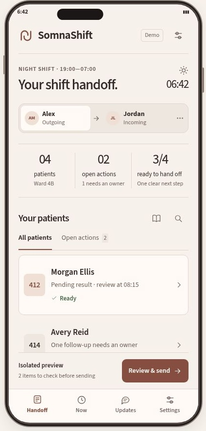

<p align="center">
  
</p>

<h1 align="center">SomnaShift</h1>
<p align="center">Patient notes, named follow-ups and the exact version you reviewed.<br>A mobile shift-handoff prototype by <strong>Robert Vaganian</strong>.</p>

<p align="center">
  <a href="https://somnashift.robertvaganyan.chatgpt.site/case-study">Case study</a> ·
  <a href="https://somnashift.robertvaganyan.chatgpt.site/shift?scene=draft">Interactive prototype</a> ·
  <a href="#on-device-ai-find-the-change-keep-the-source">On-device AI</a> ·
  <a href="#run-locally">Run locally</a>
</p>


## The handoff is only the start

The outgoing colleague needs to leave a clear record. The incoming colleague needs to know what changed, what they have reviewed and what still needs doing. SomnaShift connects those tasks without treating a sent message as a completed handoff.

| Moment | What the prototype does |
| --- | --- |
| Prepare | Brings four fictional patient notes together; surfaces missing task owners before sending. |
| Review | Separates sent, delivered, viewed and acknowledged. A confirmation applies to one submitted version. |
| Update | Shows exact differences and keeps the earlier acknowledgment attached to its original version. |
| Follow through | Groups assigned actions by expected time. A factual completion goes into a separate work history. |
| Resume | Recovers the patient, reading position and unsent input locally, without submitting it. |

## On-device AI: find the change, keep the source

**Ask about a change in plain English. Get the original record beside it.**

“Who took over the family update?” finds room 414’s owner change. “Which deadline moved?” finds the expected-time change. The application calculates the differences; a small local semantic model ranks the relevant records. Names, times and before-and-after values come directly from the submitted snapshots.


The visible **AI · Ask about changes** button opens search from the workspace. If there is no readable version pair yet, it offers a separate sample tab and preserves the current draft.

| Mode | What runs |
| --- | --- |
| Guided demo | Clearly labelled, prepared matches. Opens immediately; no model runs. |
| On-device AI | Real semantic search with quantized **all-MiniLM-L6-v2**, inside a Web Worker. An explicit **Load model & search** action starts it. |

**No API key, inference server or paid inference account.** Model weights are about **23 MB**; the first download including runtime assets is approximately **50 MB**. Files are fetched from Hugging Face and jsDelivr after opt-in. Questions and source records are processed on the device.

Search supports stop, retry, unload and model-cache removal. Source links open the exact submitted patient version. A question without a close match returns no answer. The model does not generate clinical advice, edit records or acknowledge a handoff.

First use needs a connection. Later reuse depends on retained browser caches and device resources; full offline availability is not guaranteed. [Implementation, scope and checked queries →](docs/on-device-search.md)

[Open the local-search sample](https://somnashift.robertvaganyan.chatgpt.site/shift?scene=assist&screen=detail&brief=1&briefmode=local) · [Read the AI case-study section](https://somnashift.robertvaganyan.chatgpt.site/case-study#on-device-ai)

## Designed for the working screen

Porcelain, warm ink and copper keep the main interface quiet. Twilight and Amber offer two darker appearances. Source Sans 3 carries working text; Newsreader is reserved for editorial headings. Both fonts are self-hosted.

The phone layout keeps navigation and the version-specific action within reach. Patient notes use 16 px text, with a 19 px larger-text setting. Dialogs have one scrolling body, consistent owner menus and visible close controls. Motion gives short press and transition feedback, while reduced motion removes movement without delaying the action.

<table>
  <tr>
    <td align="center"></td>
    <td align="center"></td>
    <td align="center"></td>
  </tr>
  <tr><td align="center">Prepare</td><td align="center">Review the change</td><td align="center">Follow through</td></tr>
</table>

Three decisions hold the flow together:

- **Review belongs to a version.** An update asks for a fresh review; it does not silently carry the earlier confirmation forward.
- **Work belongs to a person.** Follow-ups have an owner and expected time. Completion records retain their author, time and source version; a correction appends a reopening reason.
- **Recovery preserves intent.** Restored text stays unsent. Send and acknowledgment confirmations are never restored as completed.

[Interface decisions](docs/design-system.md) · [Reading and controls](docs/readability-review.md)

## Explore the prototype

| Start here | What to try |
| --- | --- |
| [Outgoing handoff](https://somnashift.robertvaganyan.chatgpt.site/shift?scene=draft) | Assign room 414’s missing owner, choose Jordan, then send and simulate delivery. |
| [Updated handoff](https://somnashift.robertvaganyan.chatgpt.site/shift?scene=update&screen=detail) | Inspect v2 and see why the earlier review still belongs to v1. |
| [Incoming work](https://somnashift.robertvaganyan.chatgpt.site/now?scene=work) | Find the next assigned action, record a result and inspect its history. |
| [Case study](https://somnashift.robertvaganyan.chatgpt.site/case-study) | Explore the decisions, live phone views and captioned 35-second screen walkthrough. |

Sample scenes use fictional records and leave the saved local workspace untouched. Demo settings includes role switching, larger text, reduced motion, offline simulation and reset. Hosted access is controlled separately; the current hosted preview is owner-private. The complete app also runs locally.

## Run locally

Requires **Node.js 22 or newer**. The core app and guided demo need no dependency installation, account or API key.

```sh
npm run dev
```

Open **http://localhost:5173**. To check or prepare a static deployment:

```sh
npm run check
npm run build
```

`check` validates JavaScript syntax and runs **87 automated checks**. `build` creates static route entries. The editable app lives in `dist/`; it is not a minified bundle. [GitHub Pages setup →](docs/publishing.md)

| Source | Responsibility |
| --- | --- |
| `dist/model.mjs` | Fictional records, immutable versions and pure state transitions |
| `dist/app.mjs` | Screens, forms, navigation and browser storage |
| `dist/handoff-view.mjs`, `dist/now-view.mjs` | Patient summaries, action filters and expected-time groups |
| `dist/workspace-view.mjs`, `dist/motion.mjs` | Input recovery, persistent DOM updates, dialog focus and scroll handling |
| `dist/change-brief.mjs`, `dist/brief-view.mjs` | Version comparisons and source-linked search results |
| `dist/brief-worker.mjs`, `dist/brief-runtime.mjs` | Local inference, explicit loading, cancellation and memory/cache controls |

## Verification and scope

The [product walkthrough](docs/portfolio-review.md) follows preparation, clarification, acknowledgment, updates and incoming work. [Verification notes](docs/verification.md) distinguish automated checks, browser observations and work still requiring evaluation. The [evaluation plan](docs/validation-plan.md) has not been run with participants.

This is an independent portfolio prototype. All patients, staff and events are fictional. Roles, delivery, the watch and voice drafting are simulations; there is no hospital connection or live microphone input. Acknowledgment confirms review of information, not clinical responsibility. Browser records are local and can be cleared.

Physical iPhone/Safari, VoiceOver and use with nurses remain untested. No clinical outcomes or complete accessibility compliance are claimed.

Project use is covered by [LICENSE](LICENSE). Self-hosted fonts and optional runtime/model dependencies have separate licenses; see [third-party notices](THIRD_PARTY_NOTICES.md).
