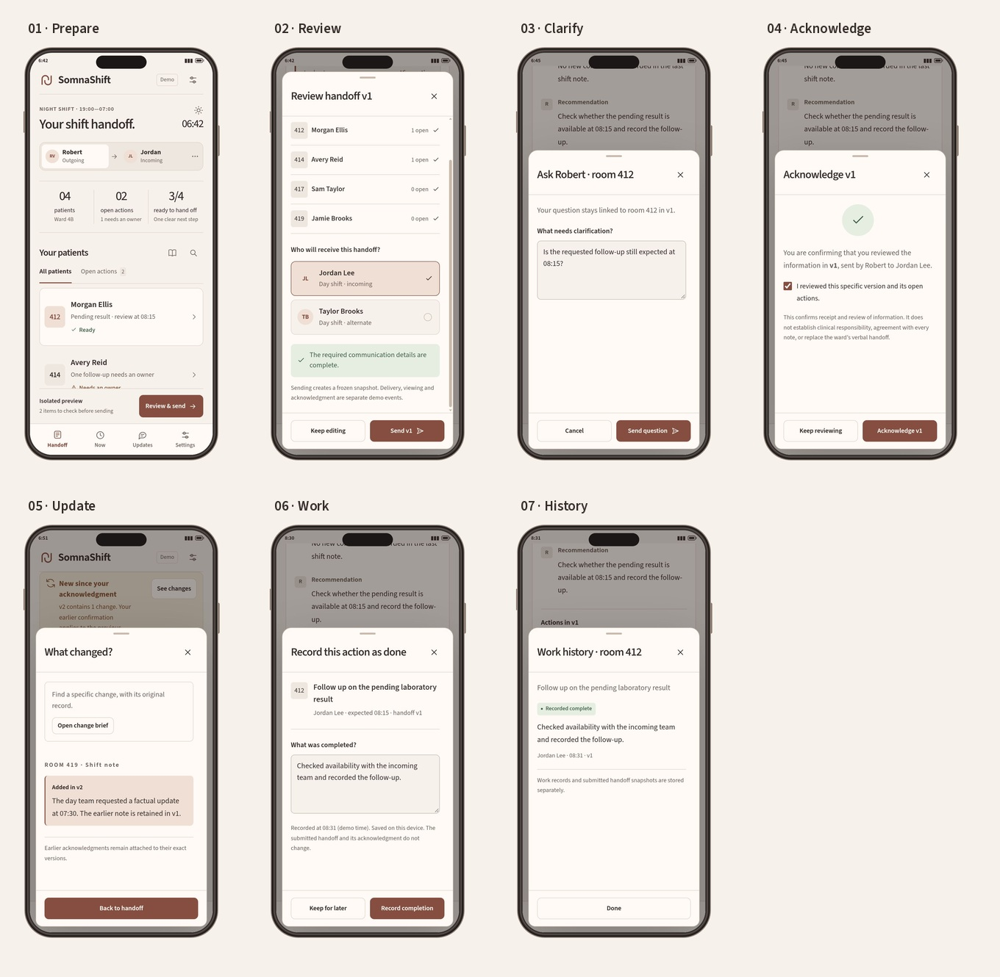
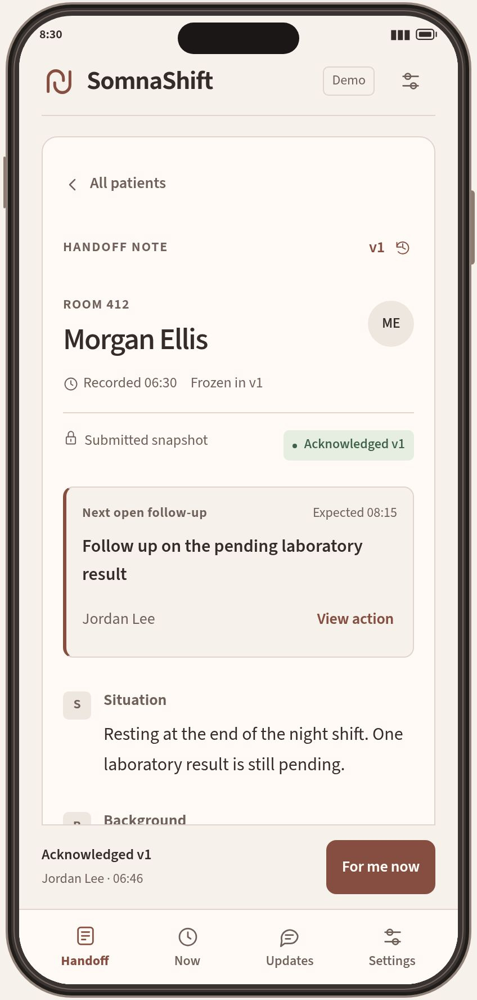
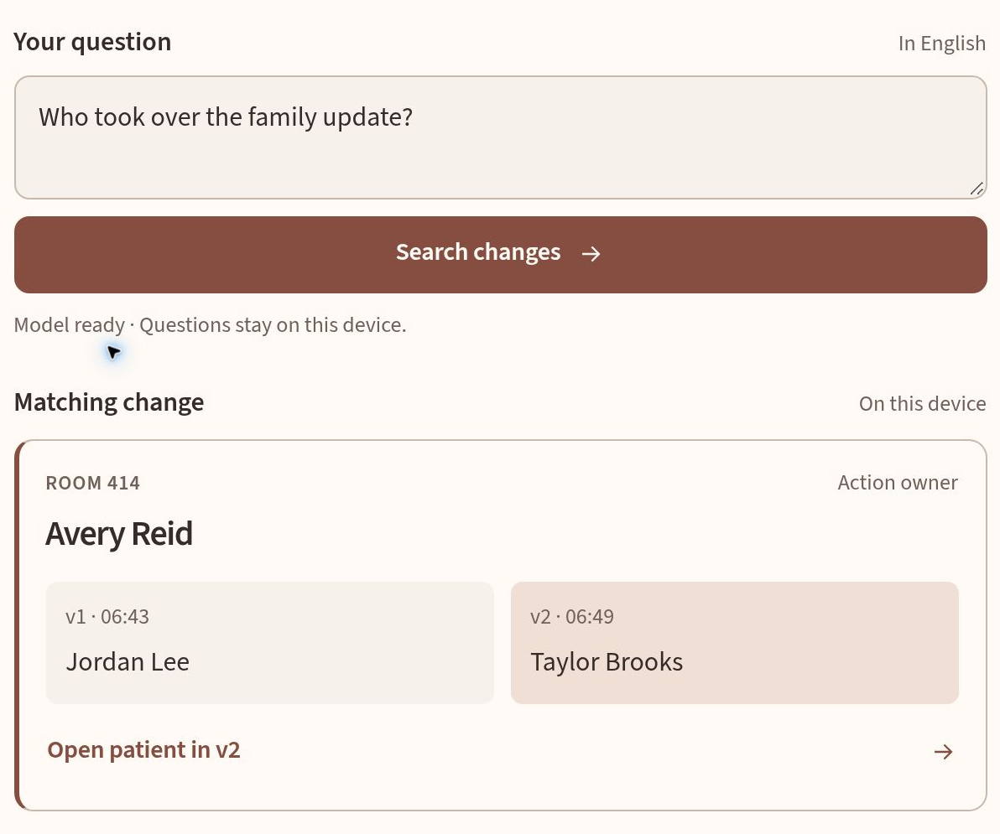

# Product walkthrough

Seven connected tasks demonstrate the handoff and the work that follows it. All records are fictional; this is a browser walkthrough, not participant or clinical research.

| Step | Task | Result |
| --- | --- | --- |
| 1 | Prepare the outgoing shift | Patient notes, the missing task owner and final-review entry are visible. |
| 2 | Assign an owner and choose Jordan | Sending creates v1. Delivery is a separate event. |
| 3 | Ask and answer a clarification | The question stays with room 412 and v1. Robert replies from Updates. |
| 4 | Acknowledge the reviewed version | An explicit review checkbox is required; confirmation belongs to v1. |
| 5 | Inspect an update | The room-419 addition appears in v2; the earlier acknowledgment remains with v1. |
| 6 | Record incoming work | A factual result is stored separately from the submitted handoff. |
| 7 | Read the work history | Author, time, source version and result remain visible. |

Individual captures: [Prepare](screenshots/portfolio/01-prepare.jpg), [Review](screenshots/portfolio/02-review.jpg), [Clarify](screenshots/portfolio/03-clarify.jpg), [Acknowledge](screenshots/portfolio/04-acknowledge.jpg), [Update](screenshots/portfolio/05-update.jpg), [Work](screenshots/portfolio/06-work.jpg), [History](screenshots/portfolio/07-history.jpg).

## Picking up the next action

The patient note starts with its nearest open follow-up, named owner and expected time. A direct link moves focus to the action section. Completed work is excluded from this summary. Archived versions retain their archive label and an Open latest action.

The Now view groups the incoming colleague’s assigned work by expected time. A completion records a result; a correction appends a reopening reason. Neither changes the submitted patient note.

## Finding a recorded difference

The visible AI entry opens a source-linked change search. Guided mode demonstrates three prepared matches. Local mode runs a real semantic model after an explicit download action. It ranks differences between two readable submitted versions and shows their original values.

[Search behavior and checked questions →](on-device-search.md)

## Reading the evidence

The phone images are captures of the working browser prototype in CSS device frames. The optional 35-second video edits those still states with holds and fades; it does not show live interaction timing. Responsive checks, keyboard observations and automated results are described in [verification](verification.md).

Physical iPhone/Safari, VoiceOver and use with nurses remain pending. See the [evaluation plan](validation-plan.md).
