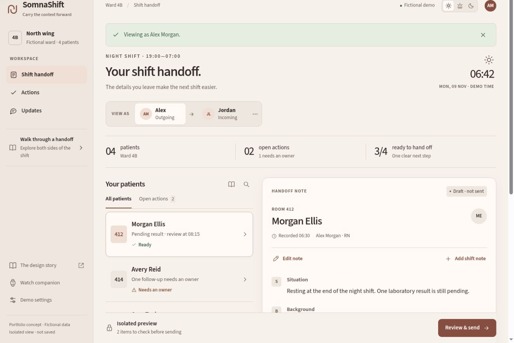
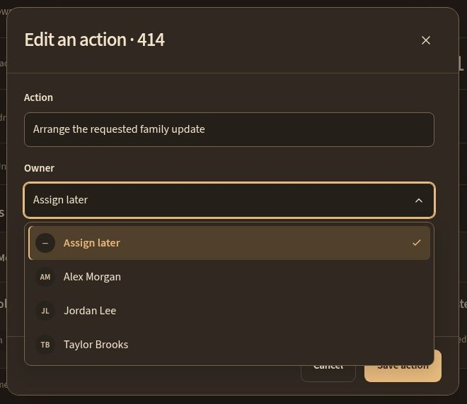
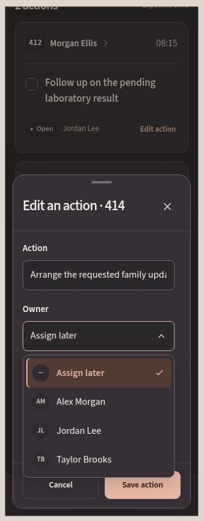
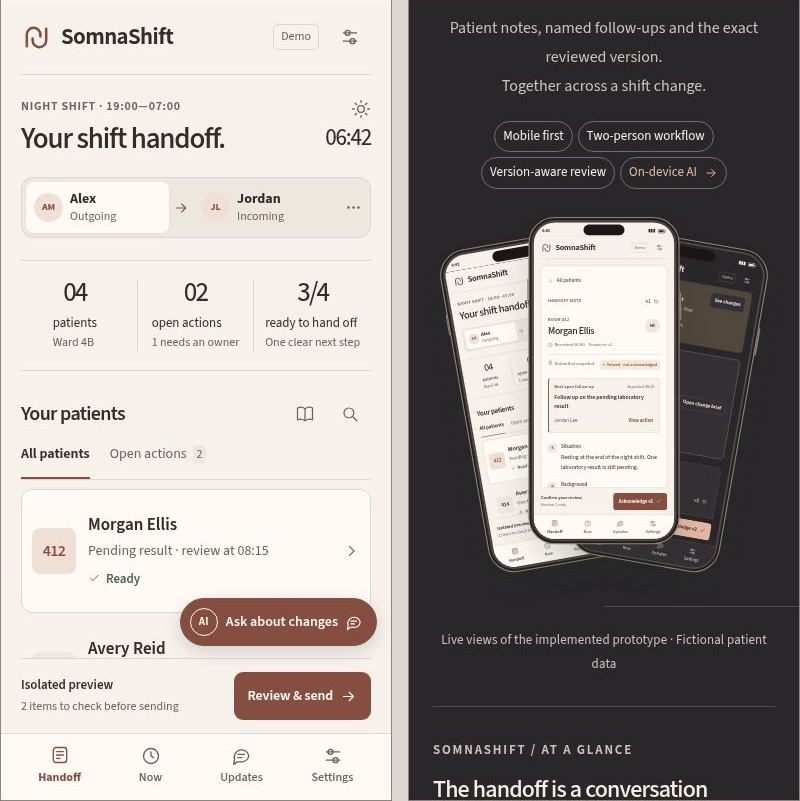

# Reading and controls

The interface uses a consistent reading scale across patient notes, action lists, messages and dialogs. These are implementation decisions supported by browser inspection, rather than participant findings.

## Reading scale

| Element | Standard size |
| --- | --- |
| Patient note | 16 px / 27.2 px line height |
| Larger-text note | 19 px / 33.25 px line height |
| Patient name | 17 px |
| Common controls | 14–15 px |
| Supporting labels | 12–14 px |

The larger-text setting retains wrapping at 320 px. Compact illustrated status bars and avatar initials use a separate scale. Newsreader is restricted to display headings; patient notes stay in Source Sans 3.

## Alignment and feedback

Navigation rows share an icon column, text column, padding and line height. The three desktop footer rows measured equal icon/text positions and zero center offset. Status notices use explicit icon, message and dismiss columns, so wrapping stays inside the message column. Success feedback floats above navigation instead of shifting the note.

Dialogs keep the title and actions visible around one scrolling body. Phone forms avoid automatically raising the keyboard on open. The version-specific acknowledgment action identifies the selected version and retains its full meaning in the confirmation dialog.

## Owner selection

The same owner menu serves draft actions and action-board filters. Four 48 px options use the active appearance tokens. The menu tracks its trigger while a sheet settles and opens above it when space below is limited. Keyboard support includes arrows, Home/End, typed names, Enter, Escape and Tab. Focus has one 2 px outline with a small offset.

## Phone presentation

The case study uses live isolated views inside CSS phone frames. The Now phone stays upright to avoid rotated text resampling. The screen matches its frame width; mobile hero spacing accounts for the full visual bounds of all three phones.

Browser checks covered the working views at 320, 375, 390, 430, 768 and 1024 px. No horizontal document overflow was observed. Contrast checks cover defined text/surface pairs; they do not establish complete accessibility compliance. Physical iPhone/Safari, virtual keyboard and screen-reader checks remain pending. See [verification](verification.md).
